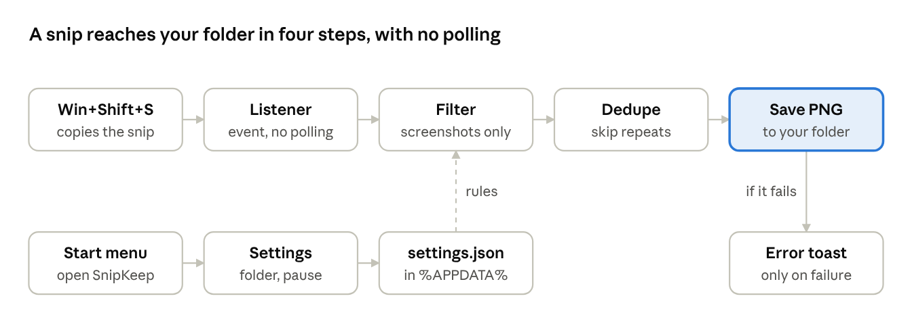

# SnipKeep: PRD and Spec

Nov 3, 2026 · Asher Wertheim · Status: approved, ready to build

## Summary

SnipKeep is a tiny Windows app that saves every Win+Shift+S screenshot to a folder you pick, like macOS does. You set the folder once and forget about it. It installs in under a minute, needs no admin rights, uses no tray icon and sends no data anywhere.

It replaces the current PowerShell script in `pc-screenshot-saver` with a real installed program: its own name, icon, Start menu entry and uninstaller.

## Problem and goals

On Windows 10, Win+Shift+S copies the snip to the clipboard only. To keep it, you open Snip & Sketch, click Save, pick a folder and type a name. That is 4 extra steps for every screenshot. macOS saves to a set folder by default.

The current script fixes this but feels like a hack. It shows as "Microsoft Windows Based Script Host" in Task Manager, its alerts say "Windows PowerShell", and it has no proper install or uninstall.

**Goals**

1. Zero extra steps per screenshot after setup.
2. Feels like a real, trusted Windows app.
3. Small and light enough that you never notice it running.
4. A clean, well-documented repo that works as a portfolio piece.

**Success metrics**

| Metric | Target |
| --- | --- |
| Install to first saved screenshot | under 60 seconds |
| Steps per screenshot after setup | 0 |
| Installer size | under 2 MB |
| Memory while idle | under 30 MB |
| CPU while idle | 0% (event-driven, no polling) |
| Data sent off the PC | none |
| Snips missed in a 100-snip test | 0 |

## Users and user stories

The main user is a Windows 10 or 11 user who takes many screenshots for work: PMs, ops, support, QA, designers. Many came from a Mac and miss its screenshot flow. They are comfortable installing apps but do not want to configure much.

1. As a user, I want every snip saved to my folder automatically, so I never lose a screenshot.
2. As a user, I want to pick the folder once, so I do not think about it again.
3. As a user, I want the app to start with Windows, so it just works after a restart.
4. As a user, I want to open SnipKeep from the Start menu, so I can change settings without hunting for a tray icon.
5. As a user, I want to pause saving for a while, so private images I copy are not stored.
6. As a user, I want only real screenshots saved, not images I copy from a browser.
7. As a user, I want to be told only when something goes wrong, so Windows' own snip alert is the only one I see.
8. As a user, I want to uninstall it from Settings > Apps like any other program.

## Scope

v1 does one job well: catch the snip, save it, stay out of the way.

**v1 features**

| Feature | Detail |
| --- | --- |
| Auto-save | Every new clipboard screenshot saved as PNG to the chosen folder |
| Screenshots only | On by default. Skips images copied from browsers, Office and file copies |
| Duplicate guard | Skips an image identical to the last one saved |
| Settings window | Folder, file name pattern, start with Windows, screenshots only, pause |
| Open from Start menu | Launching SnipKeep while it runs opens the settings window |
| Pause / resume | One button in settings. Optional auto-resume after 15 min, 1 h or until restart |
| Start with Windows | On by default. Shows as "SnipKeep" in Task Manager > Startup |
| Error alerts only | Branded "SnipKeep" toast when a save fails, nothing on success |
| Installer | Per-user, no admin, Start menu entry, uninstall from Settings > Apps |
| Portable exe | Same app without installer, for people who prefer it |

**Later (v1.x)**

- Sub-folders by month (`2026-11\`).
- JPG option to save space.
- Open the last screenshot with a hotkey.
- winget and Microsoft Store listing.
- Code signing to remove the SmartScreen warning.

**Not doing**

- Editing, markup or annotation. Snip & Sketch already does this.
- Cloud upload or sharing.
- Our own capture tool or hotkey. We use the Windows one.
- Screenshot history or gallery UI. File Explorer does this.
- macOS or Linux versions.

## UX flows

The user sees SnipKeep twice: at setup and when they want to change something. The rest of the time it is invisible.

**Install and first run**

1. Download `SnipKeep-Setup.exe` from GitHub Releases.
2. Run it. One screen: "Install SnipKeep" with an Install button. No admin prompt.
3. On finish, SnipKeep opens the welcome window: "Where should screenshots go?" with the folder pre-filled as `Pictures\Screenshots`.
4. User clicks Change or keeps the default, then Done.
5. The window closes. A one-time toast says "SnipKeep is on. Press Win+Shift+S to try it."
6. On the first saved screenshot only, a toast says "First screenshot saved. Click to open the folder." This shows the user where files go. Later saves stay silent.

**Daily use**

1. User presses Win+Shift+S and selects an area.
2. Windows shows its own "Snip saved to clipboard" alert.
3. SnipKeep saves the PNG in under 1 second. No alert from SnipKeep.

**Change settings**

1. User opens SnipKeep from the Start menu.
2. The running copy shows its settings window. No second copy starts.
3. Changes save right away. Closing the window keeps SnipKeep running.

**Settings window**

- Status line: "Saving screenshots to D:\Shots" with a Pause button.
- Save to: folder path, Change, Open folder.
- File name: pattern with live preview, for example `Screenshot 2026-11-03 12.30.49.png`.
- Screenshots only: on / off.
- Start with Windows: on / off.
- Footer: version, "Quit SnipKeep" link, GitHub link.

**Failure**

- Folder missing or not writable: toast "SnipKeep could not save. Click to choose another folder." Click opens settings.

**Uninstall**

1. Settings > Apps > SnipKeep > Uninstall.
2. Removes the app, Start menu entry and startup entry. Asks whether to keep settings. Never deletes screenshots.

## Spec sheet

SnipKeep is a C# WinForms app on .NET Framework 4.8, which ships inside Windows 10 (1903+) and 11. That keeps the exe under 300 KB with nothing extra to install.

| Item | Choice | Why |
| --- | --- | --- |
| Language / UI | C#, WinForms | Native look, small, no runtime download |
| Runtime | .NET Framework 4.8 | Built into Windows 10 1903+ and 11 |
| Clipboard watch | `AddClipboardFormatListener` on a hidden window | Event-driven, 0% CPU when idle. Replaces the 500 ms polling in the script |
| Single instance | Named mutex + named event | Second launch tells the first to show settings, then exits |
| Settings | `%APPDATA%\SnipKeep\settings.json` | Easy to read, back up and delete |
| Start with Windows | `HKCU\...\CurrentVersion\Run` value "SnipKeep" | Shows as SnipKeep in Task Manager. No admin |
| Alerts | Short-lived notification icon, errors only | Toast header shows "SnipKeep" with our icon. Nothing stays in the tray |
| Installer | Inno Setup, per-user, `%LOCALAPPDATA%\Programs\SnipKeep` | No admin prompt. Registers in Settings > Apps |
| Build and release | GitHub Actions on `windows-latest`, triggered by a version tag | Every release is built the same way, from source |
| License | MIT | Standard for portfolio open source |

The top row runs on every clipboard change. The bottom row runs only when the user opens SnipKeep.

**Screenshots-only rule**

A clipboard update counts as a screenshot when it holds a bitmap and none of these formats: `HTML Format`, `FileDrop`, `Rich Text Format`, or Office drawing formats. Browsers and Office add those when you copy an image. Snip & Sketch does not. This rule must be checked on real Windows 10 and 11 machines before release.

**Settings file**

| Key | Default |
| --- | --- |
| `folder` | `%USERPROFILE%\Pictures\Screenshots` |
| `namePattern` | `Screenshot {yyyy-MM-dd HH.mm.ss}` |
| `screenshotsOnly` | true |
| `startWithWindows` | true |
| `paused` / `pausedUntil` | false / empty |

Name clashes in the same second get ` (2)`, ` (3)` and so on. Characters Windows does not allow are removed from the pattern.

**Performance budgets**

| Measure | Budget |
| --- | --- |
| Snip to file on disk | under 1 s for a 4K screenshot |
| Memory, idle | under 30 MB |
| CPU, idle | 0% |
| App startup | under 0.5 s |
| Exe / installer size | under 300 KB / under 2 MB |

## Release, testing and risks

v1.0 ships as a GitHub Release with two files: `SnipKeep-Setup.exe` and `SnipKeep-portable.zip`. The repo gets a README with a demo GIF, this PRD under `docs/`, and the old script moved to a `legacy/` folder.

**Release steps**

1. Build the app and installer in GitHub Actions.
2. Asher runs the test checklist on his Windows 10 PC.
3. Fix, tag `v1.0.0`, publish the release.
4. Add SnipKeep to the portfolio site and pin the repo.

**Test checklist**

- [ ] Install with no admin prompt
- [ ] First run asks for the folder, default is Pictures\Screenshots
- [ ] 20 snips in a row: 20 files, none missed, no duplicates
- [ ] Image copied from Chrome: not saved when Screenshots only is on
- [ ] Image copied from Word: not saved when Screenshots only is on
- [ ] Pause, snip, resume: snip during pause not saved
- [ ] Restart Windows: SnipKeep running, shows as "SnipKeep" in Task Manager > Startup
- [ ] Open from Start menu while running: settings window, no second copy
- [ ] Folder deleted while running: error toast, click opens settings
- [ ] Uninstall: app, Start menu and startup entry gone, screenshots kept
- [ ] Idle memory under 30 MB after 1 hour

**Risks**

| Risk | Impact | Plan |
| --- | --- | --- |
| Unsigned exe shows "Windows protected your PC" | Users may not trust it | README explains "More info > Run anyway". Apply to SignPath free signing for open source later |
| Antivirus flags an unknown app that reads the clipboard | Install blocked | Open source code, built by GitHub Actions. Submit to Microsoft for review if flagged |
| Screenshots-only rule misses or blocks some images | Wrong files saved or skipped | Test on Windows 10 and 11. Setting can be turned off |
| Windows 11 Snipping Tool already auto-saves | Less need on 11 | Position as Windows 10 first. On 11 it still adds folder choice and naming |
| Claude cannot run Windows builds directly | Bugs found late | Build in GitHub Actions. Asher tests each build |

**Decisions (Nov 3, 2026)**

- Name: SnipKeep. The only exact match found is a small, inactive code-snippet repo. A paid macOS app called SnapKeep exists, so always say "for Windows" in the README and store text.
- Repo renamed from `pc-screenshot-saver` to `snipkeep`.
- Default folder: `Pictures\Screenshots`, plus a one-time toast on the first save. Desktop was rejected because OneDrive often syncs it and it fills up fast.
