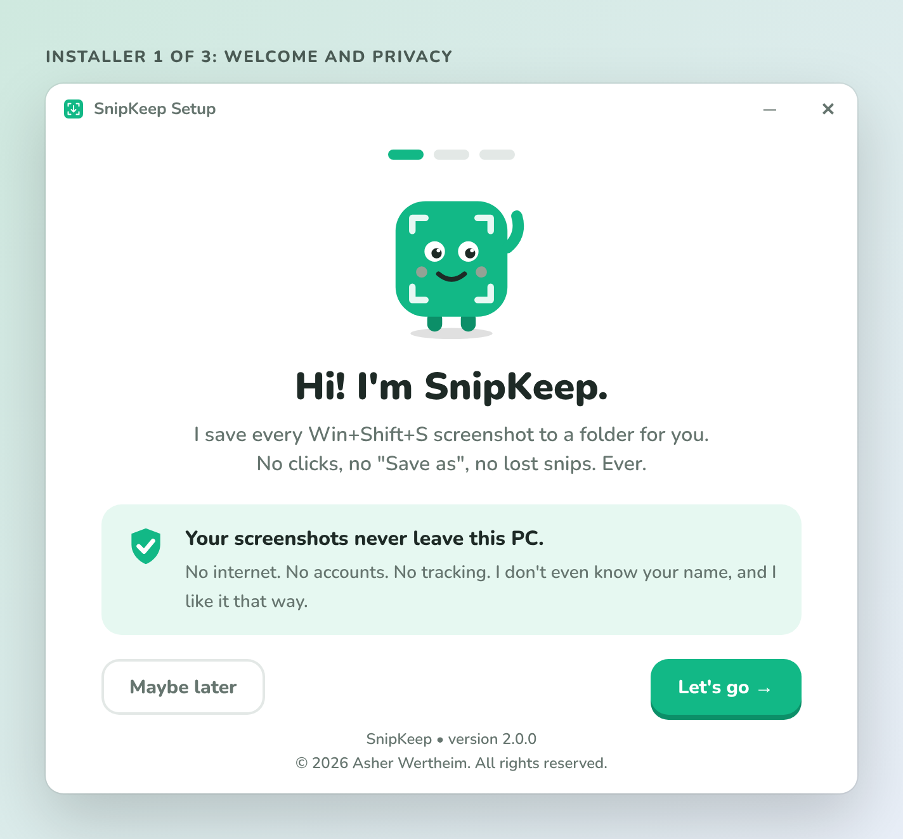
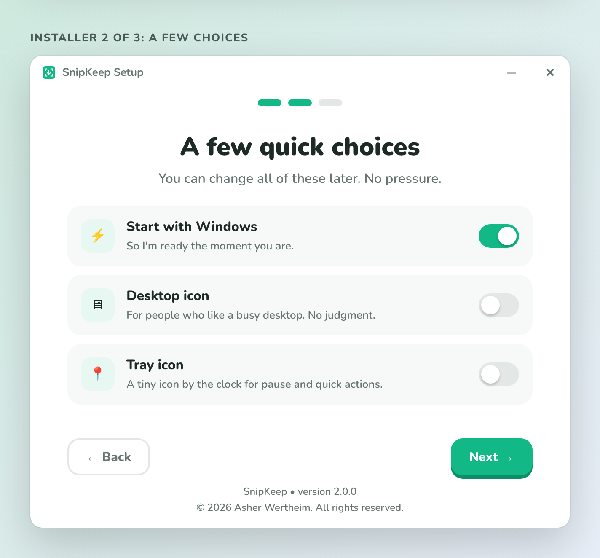
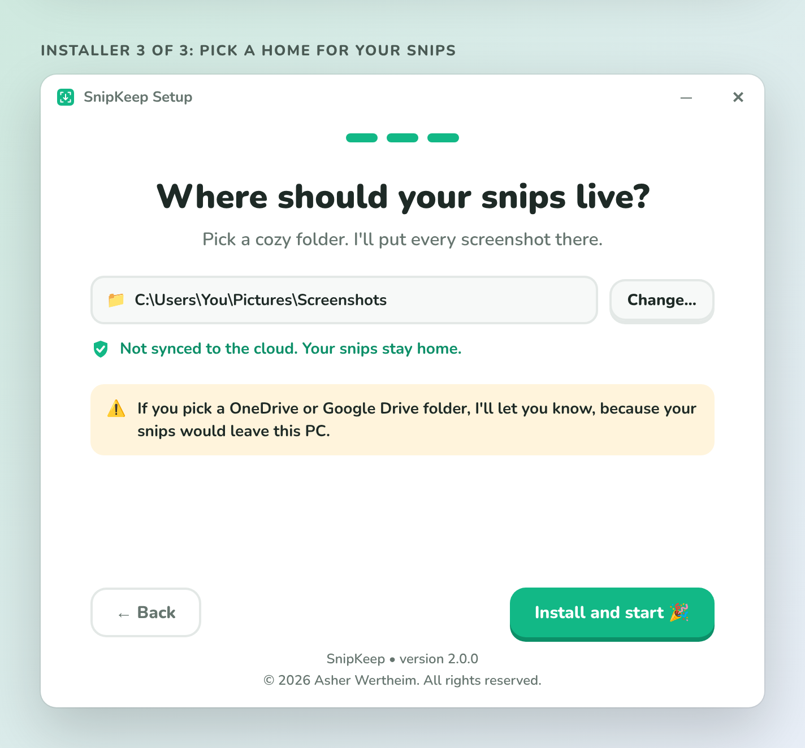
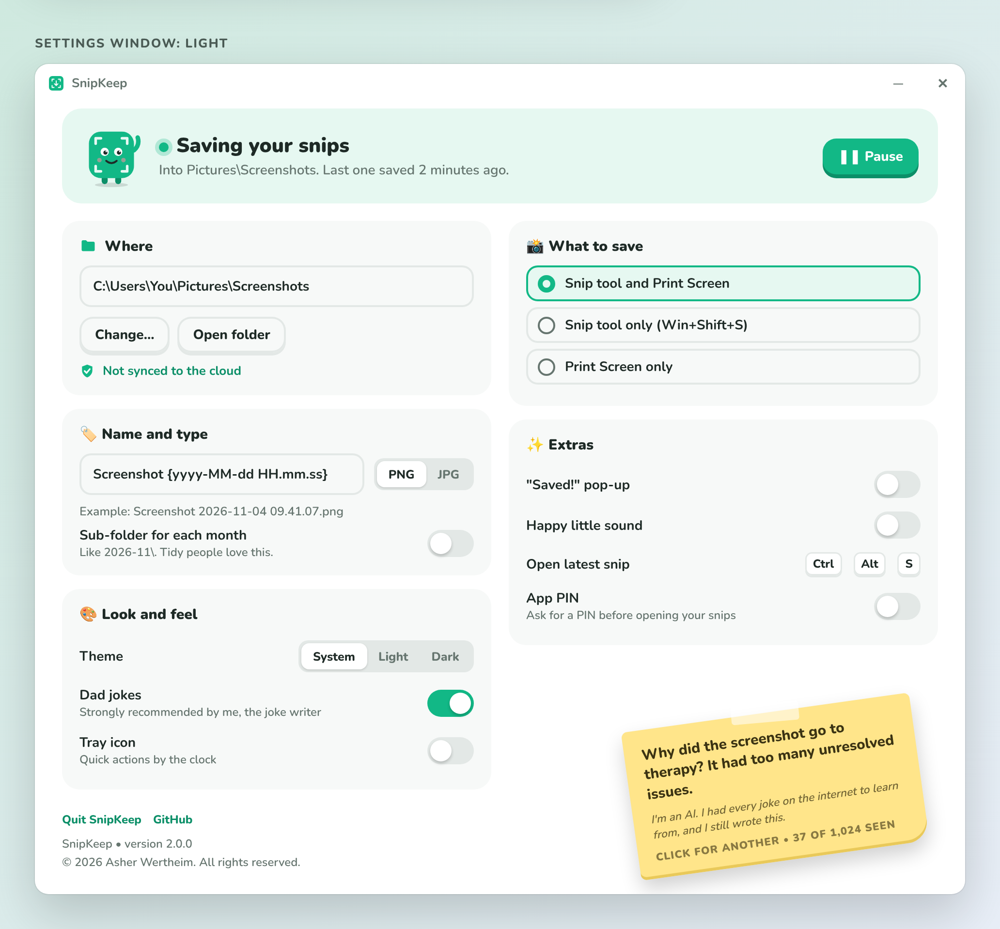
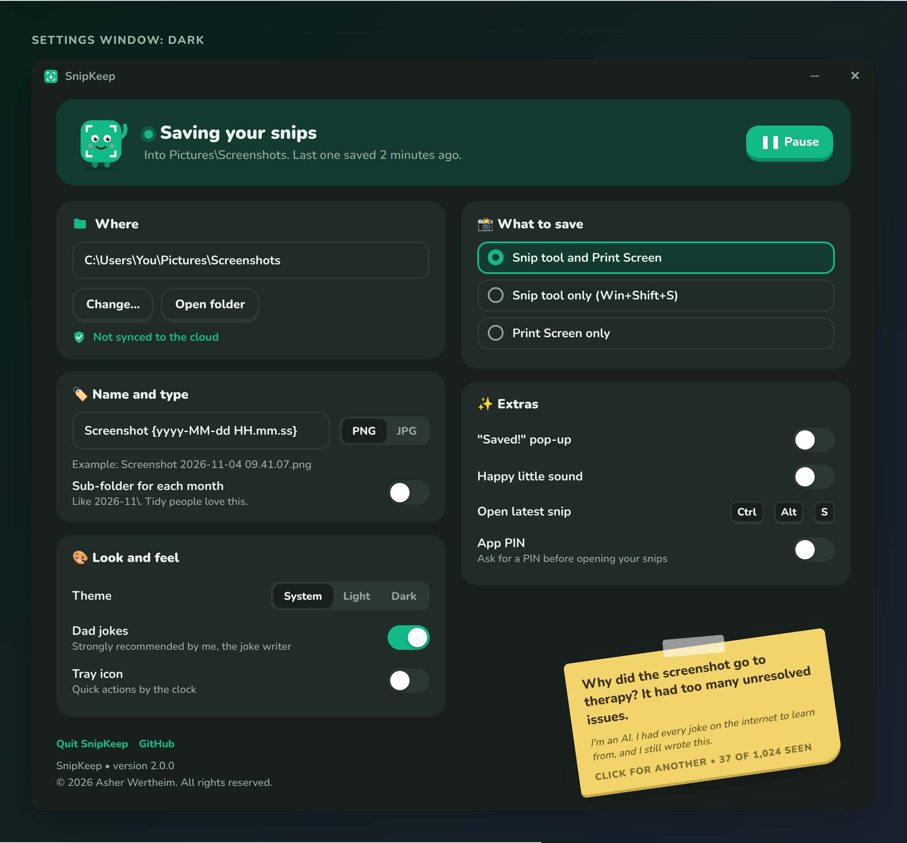
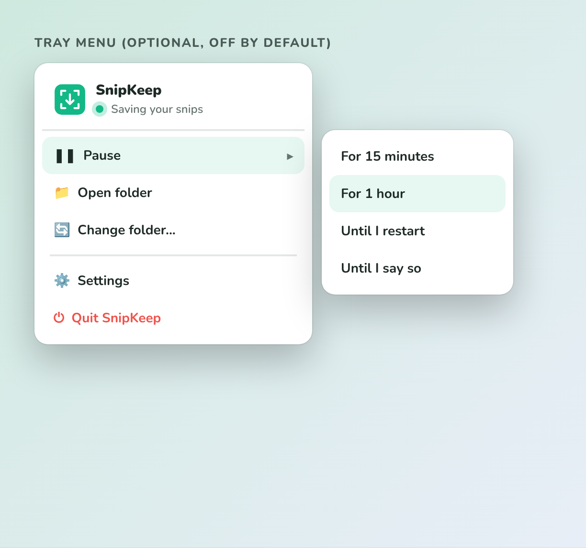
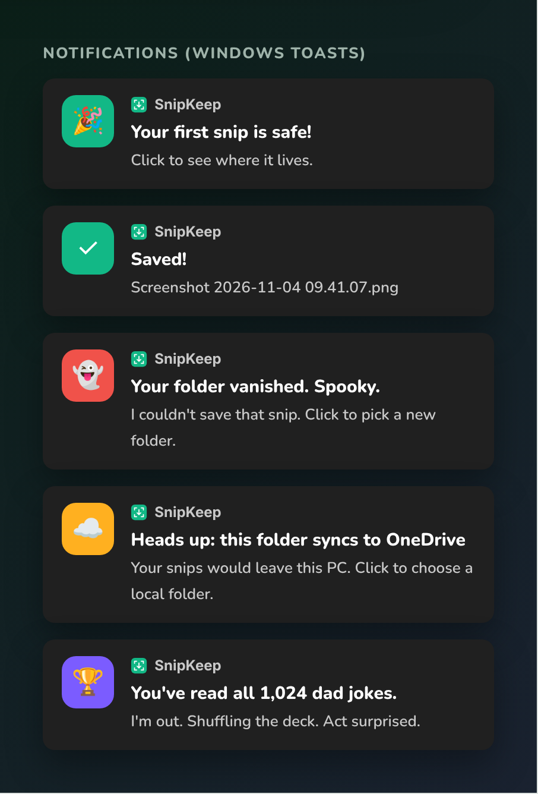
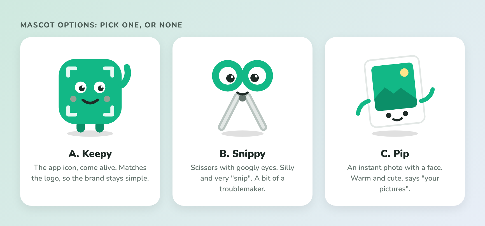

# SnipKeep v2 mockups

Draft mockups for the v2 spec in `docs/PRD.md`. Nothing here is built yet. Open `v2-mockups.html` in a browser, or look at the images below.

The style follows the v2 decisions: the logo in brand green (`#12B886`), chunky rounded buttons, playful copy, light and dark themes, and the footer on every window.

## Installer

| 1. Welcome and privacy | 2. A few choices | 3. Pick a folder |
| --- | --- | --- |
|  |  |  |

- Defaults: Start with Windows on, desktop icon off, tray icon off.
- Screen 3 shows the cloud guard: a green line when the folder is local, a warning when it is synced by OneDrive or Google Drive.

## Settings window

- The top card shows the status and the Pause button.
- "What to save" is the 3-way capture source setting.
- The joke note sits in the bottom right corner, tilted about 8 degrees. Click it for the next joke.

## Tray menu and notifications

| Tray menu | Notifications |
| --- | --- |
|  |  |

## Mascot options

A. Keepy, the app icon come alive (used in the other mockups as a placeholder). B. Snippy, scissors with googly eyes. C. Pip, an instant photo with a face.

## Joke tone

See [jokes-sample.md](jokes-sample.md) for 30 sample jokes with their AI comments.

## Questions for Asher

1. Which mascot: A, B, C or none?
2. Is the copy tone right, or too much?
3. Settings layout: one window with cards (as shown), or tabs (General, Look, Extras)?
4. Should the top card show a snip count, for example "142 snips saved"?
5. Default hotkey for "Open latest snip": is Ctrl+Alt+S good?
6. Any screen you want to see first in WPF as a working prototype?
